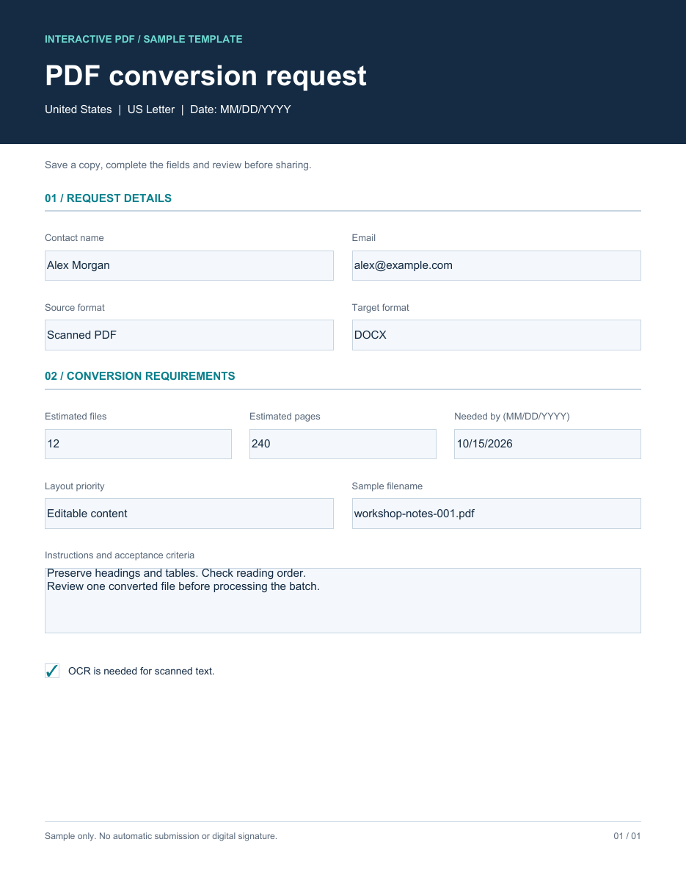

# PDF Conversion Services Samples

Scope a PDF conversion job before production: source format, target format, page count and layout priorities. Download unbranded interactive PDF samples for the United States, United Kingdom and Australia, inspect actual PDF screenshots, or adapt the source.

## Download a fillable template

| Country | Paper and date format | Blank interactive PDF | Completed example screenshot |
|---|---|---|---|
| United States | Letter; MM/DD/YYYY | [Download US template](conversion-us-fillable.pdf) | [View US example](conversion-us-filled.png) |
| United Kingdom | A4; DD/MM/YYYY | [Download UK template](conversion-uk-fillable.pdf) | [View UK example](conversion-uk-filled.png) |
| Australia | A4; DD/MM/YYYY | [Download Australia template](conversion-au-fillable.pdf) | [View Australian example](conversion-au-filled.png) |



Screenshots show filled examples for illustration. The downloadable PDFs are blank and editable. All names and entries in screenshots are fictional. No sample contains a company name or logo.

## How to use the sample

State the source and target formats, estimate the page count, and describe how closely the converted output must match the source. Attach a representative source file through your chosen secure channel. This repository contains request templates and a QA checklist; it is not a conversion engine and does not demonstrate a completed PDF-to-Word or PDF-to-Excel conversion.

Download the PDF before filling it. Save it, close it, reopen it and check that the values remain. Form support depends on your PDF viewer; test your intended reader before distributing a custom version.

## What is included

- Three country variants of the pdf conversion request.
- Blank and filled screenshots rendered with Poppler, not designed mockups.
- Python source, field schema and automated fill/save/reopen validation results.
- [Usage and quality guide](USAGE.md), [country notes](COUNTRIES.md) and [search intent map](SEARCH-INTENT.md).

## Need a custom version?

For project-specific work, see [PDF conversion services](https://pdfserviceexperts.com/services/document-conversion-services/). Include your source format, approximate volume and desired output when asking for a quote.

## Rebuild and validate

```sh
python -m pip install -r requirements.txt
python build_samples.py
# Optional: install Poppler and put pdftoppm on PATH to regenerate PNGs
python build_samples.py --render
```

The validation checks canonical AcroForm fields, unique page widgets, saved values and appearance streams. Automated checks were run during preparation; interactive clicking in third-party desktop or mobile readers has not been tested. These general business samples have not been audited for PDF/UA, WCAG or jurisdiction-specific compliance. They contain no JavaScript or remote submission actions.

## License

Original templates, screenshots, code and documentation are provided under the [MIT License](LICENSE). External websites retain their own terms and branding.
